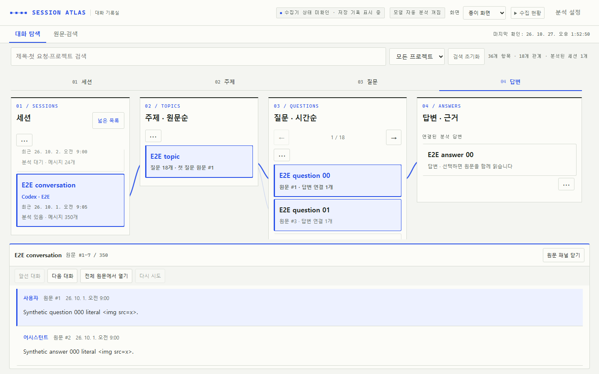

# Session Atlas

Local-first archive and viewer for Codex CLI/Desktop and Claude Code conversation transcripts.

Session Atlas reads the JSONL session files read-only, stores user/assistant text messages in SQLite, and serves a Korean-language local web viewer: a mind map of session → topic → question → answer (session → request → response until a session is analysed), full-text search and an original-message reader panel. Semantic analysis is opt-in and never runs during collection or viewing. This is a reconstruction of conversation knowledge, not access to the model's actual internal context.



> **Status: experimental MVP.** The Codex analyzer has not been verified end-to-end on an authenticated installation, and real model/API calls are mocked in tests. The OpenAI Decisions API used for topic assignment (`POST /v1/decisions`, model `gpt-6-luna`) became generally available on 2026-10-22; the request format in `decisions_topics.py` matches its documented choice-question shape, but live calls are not covered by automated tests.

## What it does

- Read-only incremental collection from `CODEX_HOME/sessions/**/rollout-*.jsonl` and `archived_sessions`, plus local Claude Code `projects/**/*.jsonl`
- SQLite checkpointing, session deduplication and user/assistant text-only normalization; polls for newly appended session messages
- Mind map, full-text search and an original-message reader panel with paging, follow-latest and font size, all without model calls
- Editable display names and topic grouping kept in a sidecar file; original messages and saved analyses are never rewritten
- Export a session transcript for [Conversation Map](https://github.com/tonitalej/conversation-map) and import its analyzed `map.json`, merging evidence across sessions only on unambiguous project + classification + exactly normalized title matches
- Export searchable offline HTML and graph JSON
- Opt-in automated analysis with `codex exec` and a separate Conversation Map checkout, optionally followed by OpenAI Decisions topic assignment

## Quick start (Windows PowerShell)

```powershell
git clone https://github.com/jangmalza/session-atlas.git
cd session-atlas
python --version
python .\context_graph.py --claude-home "$HOME\.claude" watch --live-dir "$HOME\.codex-context-graph\live" --port 8765
# Open http://127.0.0.1:8765 in your browser. Ctrl+C stops this foreground run.
```

Python 3.10+ (3.14 recommended for compressed archives); Windows 11 supported. By default, Codex sessions are read from `$env:CODEX_HOME` or `$HOME\.codex`. The SQLite database is written outside the repository to `$HOME\.codex-context-graph\knowledge.db`. Omit `--claude-home` to collect only Codex.

The mind map, full-text search and original-message reader work without model calls. Semantic topic/answer graphs use explicitly imported or requested analyses. Original files are never rewritten.

## How it works

- **Collection** — the `watch` loop scans Codex (and optionally Claude Code) JSONL read-only and incrementally, checkpoints each file in SQLite and deduplicates sessions and event/response mirrors. It never calls a model. See [docs/collection.md](docs/collection.md).
- **Storage** — messages, checkpoints and imported maps live in one SQLite database outside the repository; display names and topic grouping live in a `<database-stem>.topic-display.json` sidecar; original transcript files and saved analyses are never rewritten.
- **Viewer** — the live dashboard binds only to `127.0.0.1` and serves the Korean mind map UI, aggregate status, read-only message/search queries and explicit local display edits. `serve` opens a read-only viewer beside a running collector, optionally behind a private Tailscale Serve route. See [docs/viewer.md](docs/viewer.md).
- **Analysis** — explicit opt-in only: `analyze --allow-model`, `--topic-classifier decisions --allow-api`, or the confirmed **이 세션 분석** job in the dashboard. Every draft is validated against the full transcript before import; a failed run never replaces a stored graph. See [docs/analysis.md](docs/analysis.md).
- **Runtime** — `service_runtime.py` supervises one collector and any viewers, with optional Windows login autostart; `backup`/`restore` use SQLite's online backup API and verify the archive before writing a new database. See [docs/runtime-and-backup.md](docs/runtime-and-backup.md).

## Project layout

| Module | Role |
| --- | --- |
| `context_graph.py` | Collector, SQLite schema, cross-session graph and CLI entry point |
| `analysis_pipeline.py` | Opt-in Codex analysis, Conversation Map validation and Decisions topic assignment (recently split out of `context_graph.py`) |
| `live_dashboard.py` | Loopback HTTP dashboard and JSON endpoints |
| `session_timeline.py` | Read-only message, context, chronology and search queries behind the reader panel |
| `analysis_control.py` | Explicitly confirmed single-session analysis jobs with staging and backup |
| `analysis_credentials.py` | Decisions key storage: Windows Credential Manager, or the OS keychain through `keyring` elsewhere |
| `decisions_topics.py` | Decisions API client with cache |
| `service_runtime.py` | Process supervisor and Windows login autostart |
| `source_adapters.py` | Claude Code JSONL adapter |
| `backup_store.py` | Verified backup/restore |
| `topic_display.py` / `topic_overlays.py` | Display-name settings and assignment overlays |
| `session_metadata.py` | Read-only Codex lineage and verified fork boundaries for session titles |
| `question_timeline.py` | Offline question ordering from verified user-message evidence |
| `localize_map.py` | Korean localization of a built Conversation Map HTML |
| `ui_ko.py` | Korean labels |
| `graph_view.html/js/css`, `graph_design.css`, `live_view.js/css`, `explorer_tools.js/css`, `raw_turns.js`, `ui_theme.js/css`, `analysis_ui.html/js/css` | Front-end: mind map, live status, reader panel and search, raw turns, themes and the analysis dialogs |

## Development

```powershell
python -m unittest discover -s tests                     # Python unit tests
node --test tests/qa_timeline.test.cjs tests/session_mindmap.test.cjs tests/mindmap_lifecycle.test.cjs tests/explorer_tools.test.cjs
npm ci; npx playwright install chromium; npm run test:e2e   # Playwright E2E
uvx ruff format <files>                                  # formatting; line length 120 is set in pyproject.toml
uv pip install -e .                                      # or: pip install -e .
```

Set `E2E_PYTHON` to a Python 3.14 executable when `python` on `PATH` is not one. The editable install provides the `session-atlas` and `session-atlas-runtime` console commands; a regular wheel is not supported because the modules load their HTML/CSS/JS assets from the same directory. CI runs the unit, Node and browser tests on Ubuntu and Windows with Python 3.13/3.14 and Node 22. See [docs/testing.md](docs/testing.md).

## Documentation

- [docs/collection.md](docs/collection.md) — sources and default paths, Claude Code adapter, `.jsonl.zst` archives, `watch`, mirror deduplication, project maps for multiple worktrees
- [docs/viewer.md](docs/viewer.md) — live dashboard directory and server, snapshots, reader panel and full-text search, read-only `serve`, private Tailscale viewer
- [docs/korean-ui.md](docs/korean-ui.md) — Korean display labels: mind map, reader panel, display names and auxiliary topics, answer evidence, `localize_map.py`
- [docs/analysis.md](docs/analysis.md) — opt-in Codex analysis, Decisions topic assignment, manual map import, long-session chunking, validation recovery and caches
- [docs/runtime-and-backup.md](docs/runtime-and-backup.md) — `service_runtime.py` supervisor, login autostart, backup and restore
- [docs/testing.md](docs/testing.md) — unit, Node and Playwright tests, CI matrix, formatting, editable install
- [docs/windows-encoding.md](docs/windows-encoding.md) — CP949 encoding errors during `codex exec` and the UTF-8 fix
- [docs/architecture.md](docs/architecture.md) — data-flow diagram and known limitations

## Safety and privacy

- Collection, refresh and viewing never call a model or an external API; the old `watch --analyze` flags are rejected.
- Model and API use require `--allow-model` / `--allow-api` on the CLI, or an explicit per-session confirmation in the dashboard.
- Keys are never returned to the browser or written to app files, browser storage, databases, backups or logs; the Decisions key is stored in the current user's Windows credential set, or on macOS/Linux in the OS keychain through the optional [`keyring`](https://pypi.org/project/keyring/) package (`pip install keyring`, included by `pip install -e .`); without a usable keychain it is read from `OPENAI_API_KEY`.
- Analysis draft caches (`analysis-cache/`) contain raw conversation quotes and are git-ignored; do not share or commit them. `decisions-cache/` keeps only normalized choices, confidence and hashes.
- Backups contain collected conversations and must stay private. Stored content is not redacted; failure logs omit raw provider/validator diagnostics.

Details: [docs/analysis.md](docs/analysis.md).

## License

MIT. Conversation Map is a separate project and is not redistributed here.
